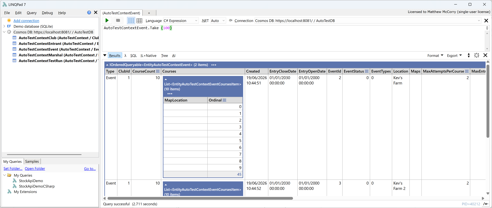

# LINQPad Cosmos DB driver

A dynamic LINQPad driver for Azure Cosmos DB **for NoSQL**, using the Cosmos .NET SDK.
The package targets LINQPad 7 (.NET 6) and LINQPad 9 (.NET 10) on Windows.



## Build and install

Install the .NET 10 SDK, then run:

```shell
dotnet pack LinqPadCosmosDB/LinqPadCosmosDB.csproj -c Release -o ./packages
```

In LINQPad, configure `packages` as a NuGet package source (keep nuget.org enabled
for dependencies). Choose **Add connection → View more drivers**, select **Show all
drivers**, find `LinqPadCosmosDB` and install it. Select **Azure Cosmos DB for NoSQL**
and enter the account HTTPS endpoint, account key and database ID. The key is stored
using LINQPad's Windows DPAPI encryption for the current user. The account must have
permission to enumerate containers as well as read the items being queried.

The connection explorer lists generated queryables; refresh the connection after
adding or removing containers or changing sampled document shapes.

For containers without a discriminator, the driver generates one queryable per
container using a readable CLR-style property name (for example,
`AutoTestContextClub`).

If sampled documents in a container contain a top-level `$type` string, the driver
generates one queryable per `$type` value (container + type) instead of one
container-wide queryable.

## Querying

In a C# expression query, use the generated property from the explorer, for example:

```csharp
Orders.Where(x => x.Category == "books")
```

You can also query any container directly with your own type. Property names can be
mapped to JSON with `JsonProperty`.

```csharp
void Main()
{
    Query<Order>("orders").Where(x => x.Category == "books").Dump();
}

public class Order
{
    [Newtonsoft.Json.JsonProperty("category")]
    public string Category { get; set; }
}
```

`Query<T>` returns the Cosmos LINQ provider's `IQueryable<T>`. Generated entity
properties are inferred from sampled documents and include primitive CLR types,
nullable value types when optional, inferred `List<T>` for arrays, and generated
nested CLR classes for nested object shapes when they can be inferred.

LINQPad can enumerate queries synchronously; for asynchronous paging use the SDK's
`ToFeedIterator()` on the query. The SDK translates supported LINQ expressions to
Cosmos SQL; not every C# expression is supported.

Parameterized SQL is available in C# queries (not LINQPad's SQL query mode):

```csharp
async Task Main()
{
    var query = new QueryDefinition("SELECT * FROM c WHERE c.category = @category")
        .WithParameter("@category", "books");
    (await Sql<JObject>("orders", query)).Dump();
}
```

`Sql<T>` reads all pages into memory. Both `Sql<T>` and `Query<T>` accept optional
`QueryRequestOptions`, including a partition key. `Client` and `Database` expose the
underlying SDK objects for other operations. This is a new driver, not a drop-in
replacement for the legacy driver's static contexts, stored procedure helpers, or
SQL query window.